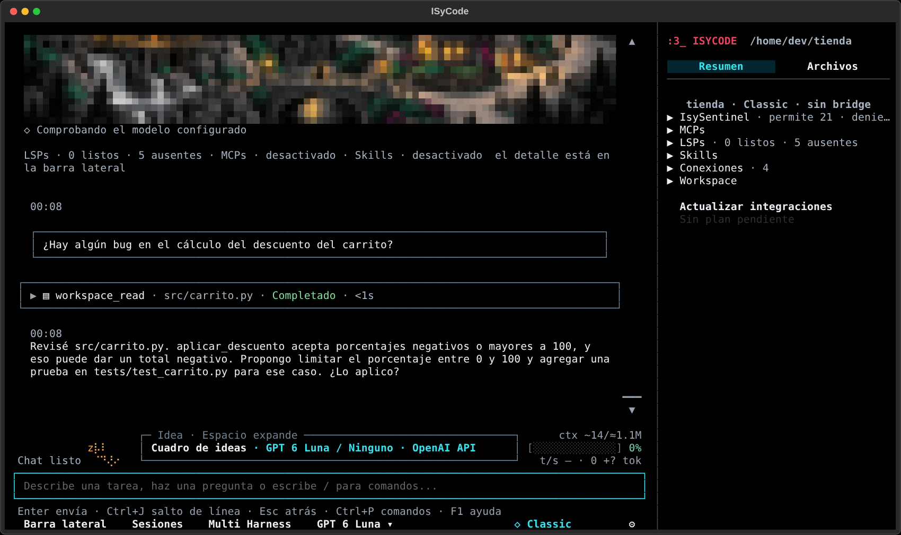
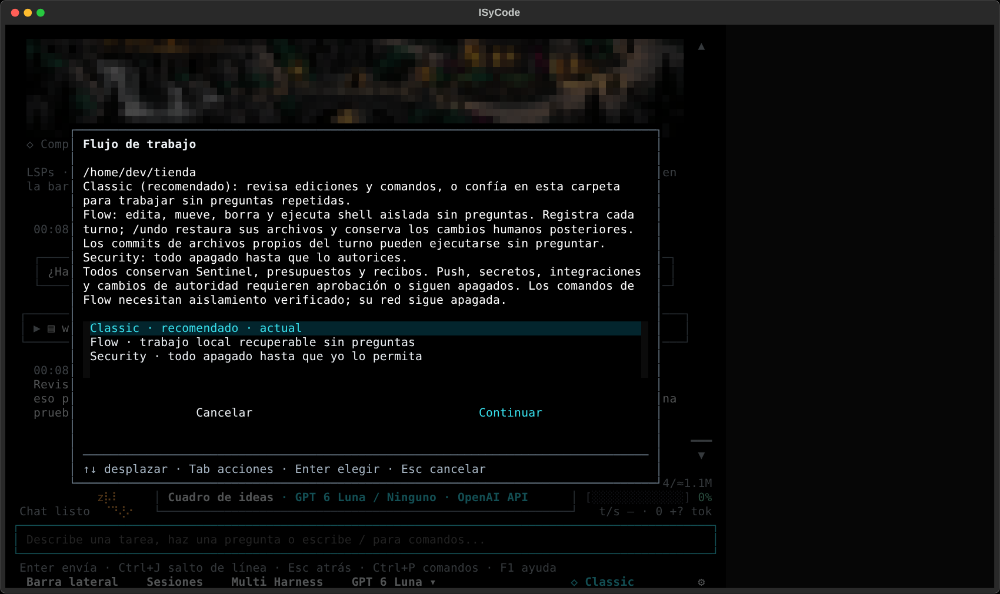
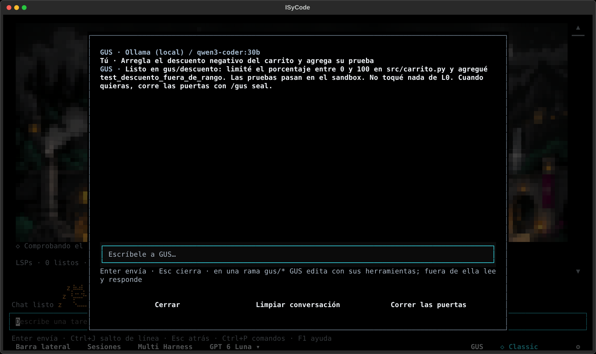
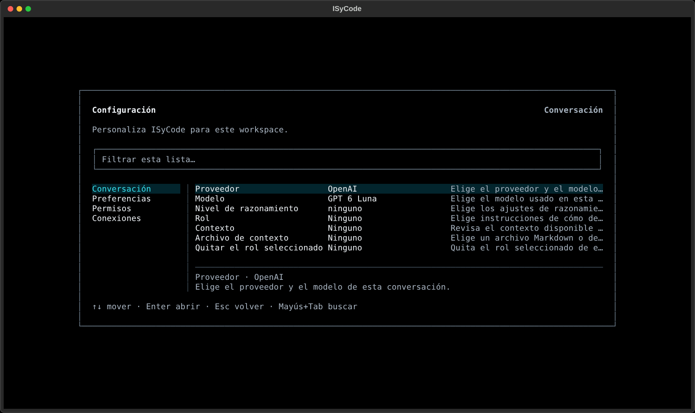

<div align="center">

# ISyCode

**Un agente de programación que vive en tu terminal.**

Una TUI para leer código, proponer cambios, correr pruebas y revisar Git
con el modelo que elijas: en la nube o local. Tú decides qué puede hacer
en cada proyecto.

[Instalar](#instalar) · [Guía de uso](docs/GUIA.md) ·
[Documentación](docs/reference/README.md) · [Roadmap](docs/ROADMAP.md) ·
[Reportar un problema](https://github.com/DannyBaanks/ISyCode/issues)



</div>

## Instalar

Necesitas **Python 3.10 o posterior** y Git.

**Linux / macOS**
```bash
curl -fsSL https://raw.githubusercontent.com/DannyBaanks/ISyCode/main/install.sh | bash
```

**Windows (PowerShell)**
```powershell
irm https://raw.githubusercontent.com/DannyBaanks/ISyCode/main/install.ps1 | iex
```

Abre una terminal en tu proyecto y ejecuta:
```bash
isycode
```

Para actualizar: `isycode actualizar`.

<details>
<summary><b>Instalación manual desde el código (desarrolladores)</b></summary>

```bash
git clone https://github.com/DannyBaanks/ISyCode.git
cd ISyCode
./install.sh
```

O con venv manual:
```bash
python3 -m venv .venv
. .venv/bin/activate
python -m pip install -e .
isycode
```

En Windows, desde el checkout: `& .\scripts\install-windows.ps1` y luego
`.venv\Scripts\isycode.exe` ([paridad de plataformas](docs/platform-parity/GUIA.md)).
Para Claude nativo: `python -m pip install -e '.[anthropic]'`.
</details>

**Primeros pasos**

1. Elige un workspace **recurrente**, para guardar conversaciones, o **temporal**.
2. Configura tu proveedor en **Configuración → Conversación → Proveedor**.
3. Pide algo concreto: «Explícame este módulo» o «Añade esta prueba».

En Linux, la ejecución aislada de comandos usa **bubblewrap y libseccomp**. Más
detalle en [instalación y actualización](docs/reference/installation.md).

## Qué puedes hacer

- **Del código al cambio.** Busca archivos, lee contexto, revisa cada edición
  como diff, corre comandos en un sandbox y prepara commits.
- **El modelo que quieras.** OpenAI, Anthropic, NVIDIA NIM, OpenRouter y otros
  proveedores en la nube, o un modelo local con Ollama o llama.cpp.
- **Conversaciones que continúan.** Sesiones guardadas en tu equipo, cola de
  mensajes, búsqueda, compactación sin perder el hilo y reanudación de turnos
  interrumpidos.
- **Todo queda registrado.** Cada acción pasa por IsySentinel y queda en un
  journal con recibo.
- **Hecho para la terminal.** Panel lateral, Configuración por categorías,
  selección de texto precisa, alto contraste, ASCII y movimiento reducido.
  Disponible en español, inglés y chino.
- **Extensible.** MCP local, LSP, Skills y Multi Harness.

## Tú decides cuánto hace solo

Cambia de modo con el chip `◇ Classic` de la barra de abajo:

| Modo | Para qué |
| --- | --- |
| **Classic** | Recomendado. Revisa ediciones y comandos, o confía en la carpeta para trabajar sin preguntas repetidas |
| **Flow** | Trabaja sin preguntar en lo que se puede deshacer. Cada turno queda registrado y `/undo` lo deshace completo |
| **Security** | Todo apagado hasta que lo permitas, capacidad por capacidad |

En los tres, push, secretos, integraciones y cambios de autoridad siguen
pidiendo aprobación. [Permisos, aprobaciones e integraciones](docs/reference/authority-and-integrations.md).



## GUS, el mantenedor de ISyCode

En el repositorio de ISyCode puedes trabajar con **GUS**, un modelo con su
propio proveedor o un modelo local que mantiene y repara ISyCode. Ábrelo con
`/gus` o con el botón **GUS** de la barra de abajo.

- `/gus branch <tema>` crea su rama, con tu aprobación. Solo ahí edita, corre
  pruebas y commitea sin preguntar.
- **Nunca toca el núcleo de seguridad (L0):** IsySentinel lo impide, y si algo
  cambia de todos modos, el turno se deshace solo.
- `/undo` deshace su turno. `/gus seal` comprueba su trabajo y lo sella.
- Tú activas su trabajo al mergear su rama.



[Roadmap de GUS](docs/roadmap-gus.md) · [ADR 0013](docs/decisions/0013-gus-l1-l0.md)

## Atajos

| Acción | Atajo |
| --- | --- |
| Enviar / nueva línea | `Enter` / `Ctrl+J` |
| Detener un turno o volver | `Esc` |
| Comandos | `/` o `Ctrl+P` |
| Cambiar de rol del agente | `Shift+Tab` |
| Panel lateral | `Ctrl+B` |
| Expandir o contraer una caja | `Space` |
| Opciones de copia de una caja | Doble clic |
| Copiar el texto marcado | Selección con el ratón + `Ctrl+C` |



[Flujos, proveedores y todos los atajos](docs/reference/workflows.md).

## Documentación y comunidad

- [Guía de uso](docs/GUIA.md): primeros pasos y trabajo diario.
- [Referencia](docs/reference/README.md): instalación, comandos, permisos e integraciones.
- [Estándar visual](.agents/skills/isycode-design/SKILL.md): criterios para ampliar la TUI.
- [Contribuir](CONTRIBUTING.md) · [Seguridad](SECURITY.md) ·
  [Issues](https://github.com/DannyBaanks/ISyCode/issues).
- [Roadmap](docs/ROADMAP.md): ahora terminamos GUS y después viene un *freeze*
  para pulir todo de punta a punta.

## Estado

**v1.0.0-rc.1** (candidato a release). Más de 2,400 pruebas automáticas en
Linux y Windows. La versión final espera la prueba de usabilidad con 5
personas (gate **G9-05**, [protocolo](docs/usability-g9/GUIA.md)). Antes de
depender de una integración o plataforma, revisa
[compatibilidad y verificación](docs/reference/verification.md).

Las sesiones y preferencias se guardan en tu equipo. Si usas un proveedor
remoto, el contexto que envías se procesa en ese servicio.
